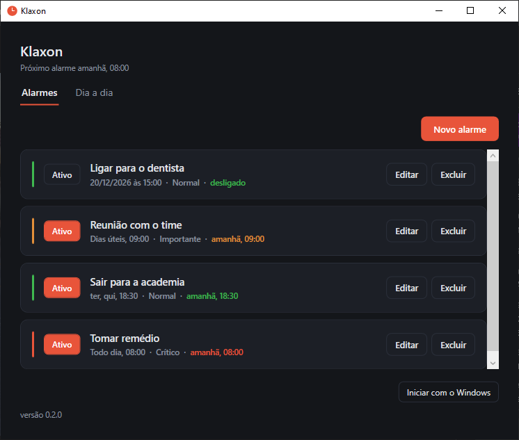
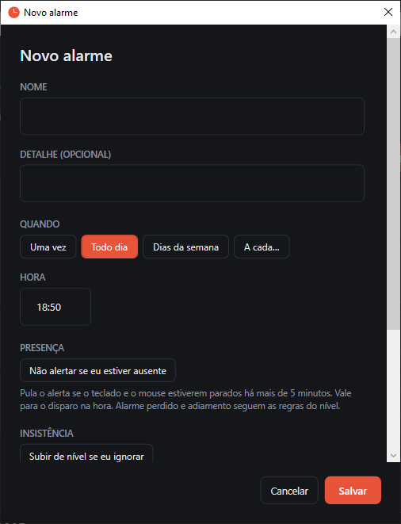
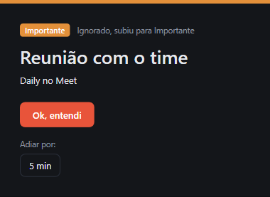

# ⏰ Klaxon

[](https://github.com/lukecarva/Klaxon/actions/workflows/ci.yml)
[](https://dotnet.microsoft.com/download/dotnet/8.0)
[](LICENSE)

Klaxon is a Windows tray alarm clock for people who spend the day at the PC. The
core idea is **urgency levels**: each alarm sets how intrusive its alert is — from
a silent toast to a full-screen overlay that only leaves with a deliberate action.
Ignored alarms **escalate** on their own, and cyclic reminders ("drink water every
45 min") stay out of the way when you're not at the computer.



## Features

- **Four urgency levels** — from a discreet toast to a full-screen overlay.
- **Automatic escalation** — ignored for 10 min or snoozed twice? The alarm comes
  back one level higher, up to Critical. The "ignorance killer".
- **Flexible schedules** — once, every day, days of the week, or every N minutes
  (with an optional time range that can cross midnight).
- **"Daily" tab** — one-click health reminders (water, stand up, eyes, stretch),
  quiet at night and skipped while you're away: no piling up alerts on an empty
  chair.
- **Sleep-resistant** — compares the wall clock every second, *catches up* on
  missed alarms and reacts to time-zone and clock changes.
- **Per-level snooze** — from unlimited to "once only", depending on urgency.
- **Sound with fade** — a built-in synthesized tone, or a file of your own.
- **Lives in the tray** — closing the window hides it; quitting is via the icon
  menu.
- **Start with Windows** — optional, via `HKCU` (no admin).
- **Bilingual (PT-BR / English)** — the language is chosen at install time and the
  app opens in it.

### Urgency levels

| Level | How it appears | How it leaves |
|---|---|---|
| 🔵 Whisper | Windows toast, no sound | On its own, in 7s |
| 🟢 Normal | Corner card, one beep | One click. Snooze 5/10/15 min freely |
| 🟠 Important | Centered window, beep every 10s | One click. Snooze 5 min, up to 3x |
| 🔴 Critical | Full screen on every monitor, looping sound | Hold the button 3s. Snooze 2 min, once only |

<table>
  <tr>
    <td></td>
    <td></td>
  </tr>
  <tr>
    <td align="center"><sub>Editor — schedule, presence and insistence</sub></td>
    <td align="center"><sub>An alert that escalated after being ignored</sub></td>
  </tr>
</table>

## Installing

Download `Klaxon-Setup-<version>.exe` (or build it below) and run it. The install
is **per-user, no admin**: it lands in `%LOCALAPPDATA%\Programs\Klaxon`, creates a
Start Menu shortcut and offers "start with Windows" and a desktop shortcut as
options. Uninstalling preserves your data in `%APPDATA%\Klaxon`.

The wizard starts by asking for the **language** (Português or English) and saves
the choice, so the app opens in the right language.

The app is *framework-dependent*: it requires the **.NET 8 Desktop Runtime (x64)**
— the installer detects its absence and shows the link before continuing.

```powershell
winget install Microsoft.DotNet.DesktopRuntime.8
```

### Building the installer

```powershell
pwsh build/build-installer.ps1
```

Output lands in `build/dist/`. Requires [Inno Setup 6](https://jrsoftware.org/isinfo.php)
once (`winget install JRSoftware.InnoSetup`).

## Development

```bash
dotnet run --project src/Klaxon.App   # run
dotnet test                           # tests (scheduler, DST, catch-up…)
```

| Project | TFM | Role |
|---|---|---|
| `src/Klaxon.Core` | `net8.0` | Domain and scheduling. Knows nothing about WPF — runs in tests with no UI |
| `src/Klaxon.App` | `net8.0-windows` | WPF: tray, windows, audio, bootstrap |
| `tests/Klaxon.Core.Tests` | `net8.0` | xUnit, with `FakeClock` in place of the real clock |

The design and project decisions are in **[docs/PLANO.md](docs/PLANO.md)**.

## Data

Everything in `%APPDATA%\Klaxon`:

- `alarms.json` — your alarms, in readable, hand-editable JSON (atomic writes; a
  corrupt file is quarantined instead of being overwritten).
- `logs\log-*.txt` — 7 days, UTF-8 with BOM, opened in shared mode (readable while
  the app runs).

## License

[MIT](LICENSE).
